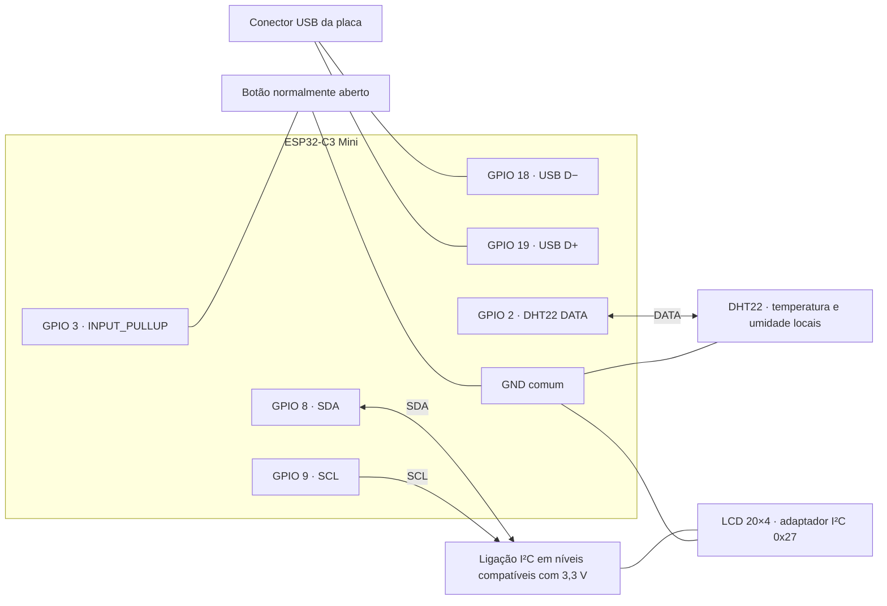
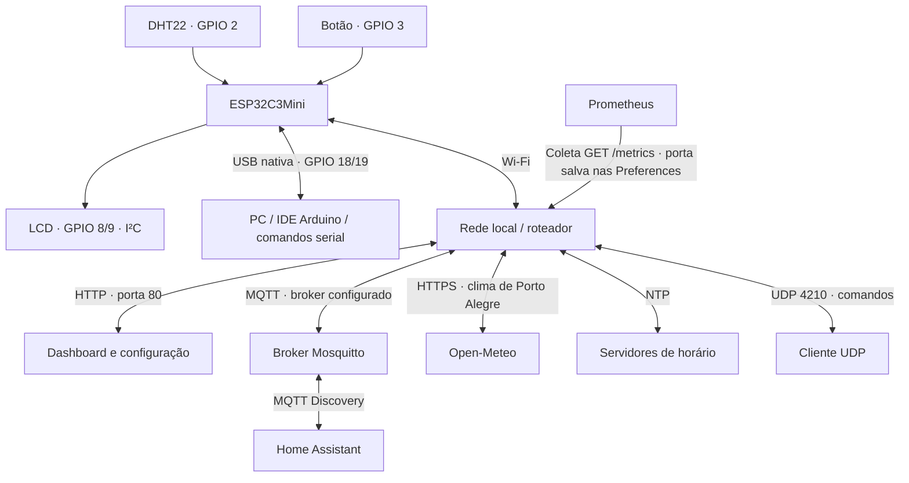

# ESP32C3Mini — pinos e diagrama do projeto

Referência do código em **21/10/2026**. Os números abaixo são **GPIOs**,
não posições físicas dos terminais. Confira a identificação impressa na placa;
o layout físico pode variar conforme o fabricante da Mini/SuperMini.

## Pinos utilizados

| Pino | Componente | Ligação/função | Configuração |
| --- | --- | --- | --- |
| **GPIO 2** | DHT22 | DATA do sensor de temperatura/umidade local | Comunicação digital bidirecional; entrada com pull-up entre leituras |
| **GPIO 3** | Botão externo | Um contato no GPIO 3 e o outro no GND | `INPUT_PULLUP`, pressionado = LOW |
| **GPIO 8** | LCD I²C | SDA, dados do adaptador do display | `Wire.begin(8, 9)` |
| **GPIO 9** | LCD I²C | SCL, clock do adaptador do display | `Wire.begin(8, 9)` |
| **GPIO 18** | USB nativa | USB D− | Ligação interna ao conector USB da placa |
| **GPIO 19** | USB nativa | USB D+ | Ligação interna ao conector USB da placa |
| **GND** | Sensor, botão e LCD | Referência comum de alimentação e sinais | Todos os módulos devem compartilhar o GND |
| **3V3 / 5V / VBUS** | Alimentação | Conforme a placa e os módulos utilizados | Não são GPIOs; a alimentação externa dos módulos não é definida pelo firmware |

O display é **20×4**, com endereço I²C **0x27** no código atual.
Wi-Fi, MQTT, HTTP, Prometheus, NTP e OTA não ocupam GPIOs adicionais.
A temperatura interna da CPU é obtida pelo sensor interno, sem fio externo.
Porto Alegre vem pela internet; não existe um segundo sensor físico externo.

## Diagrama de ligações dos sinais



O diagrama representa sinais e GND. **VCC dos módulos deve ser conferido no
hardware**: o código não permite identificar como eles estão alimentados.
O bloco de níveis I²C não afirma que um conversor já esteja instalado.
Se o adaptador do LCD usar pull-ups de SDA/SCL para 5 V, use conversão
bidirecional adequada para o lado de 3,3 V do ESP32. Não aplique 5 V aos GPIOs.
Referência: [datasheet ESP32-C3](https://documentation.espressif.com/esp32-c3_datasheet_en.html).

### Botão externo

```text
GPIO 3 ───── botão normalmente aberto ───── GND
   │
   └── pull-up interno habilitado pelo firmware
```

O botão fecha o contato com o GND; não é ligado ao 5 V ou ao pino EN/reset.
Em botões tácteis de quatro terminais, use contatos de lados eletricamente
distintos, que só ficam unidos quando pressionados.

| Ação | Resultado |
| --- | --- |
| Toque com tela apagada | Acende e volta ao início |
| Toque curto com tela acesa | Alterna início/rede ao soltar |
| Segurar por 5 segundos com tela acesa | Apaga caracteres e iluminação |
| Segunda tela sem interação por 15 segundos | Retorna ao início |

Debounce de 40 ms. O gesto de acender não dispara outra ação ao soltar ou
continuar segurando. Consultas síncronas de rede podem atrasar a aplicação
dos eventos detectados. Durante OTA, os eventos do botão são ignorados.

## Diagrama funcional



Os blocos da rede são funções lógicas: Mosquitto, Home Assistant e Prometheus
podem estar na mesma máquina. Suas portas não correspondem a pinos físicos.

## Pinos e recursos a preservar

- GPIOs **2, 8 e 9** também são pinos de configuração de boot do ESP32-C3;
  módulos ligados a eles não devem impor níveis incompatíveis durante reset.
  [Referência oficial](https://documentation.espressif.com/esp32-c3_datasheet_en.html).
- **18/19** ficam reservados para a USB nativa usada neste projeto.
- O código não configura cartão SD, relés ou entradas ADC externas; não há
  pinos desses recursos para documentar como utilizados.
- Outros GPIOs não citados não estão atribuídos pelo firmware consultado;
  confirme o esquema da placa antes de utilizá-los, inclusive conexões de
  LED, BOOT, UART e memória que possam existir na variante física.

## Referências no projeto

- [MonitorAmbiental.h](MonitorAmbiental.h): DHT22 no GPIO 2 e botão no GPIO 3.
- [MonitorAmbiental.cpp](MonitorAmbiental.cpp): I²C em 8/9, botão e navegação LCD.
- [DisplayAmbiental.cpp](DisplayAmbiental.cpp): LCD 0x27, 20 colunas e 4 linhas.
- [SensorAmbiental.cpp](SensorAmbiental.cpp): protocolo de leitura do DHT22.
- [comandos.md](comandos.md): comandos e funcionamento das telas.
- [prometheus.md](prometheus.md): métricas e porta de coleta.
- [homeassistant.md](homeassistant.md): MQTT e descoberta de entidades.

Este documento confere o mapeamento no código; não substitui inspeção das
ligações físicas ou do esquema específico da placa/módulos utilizados.
